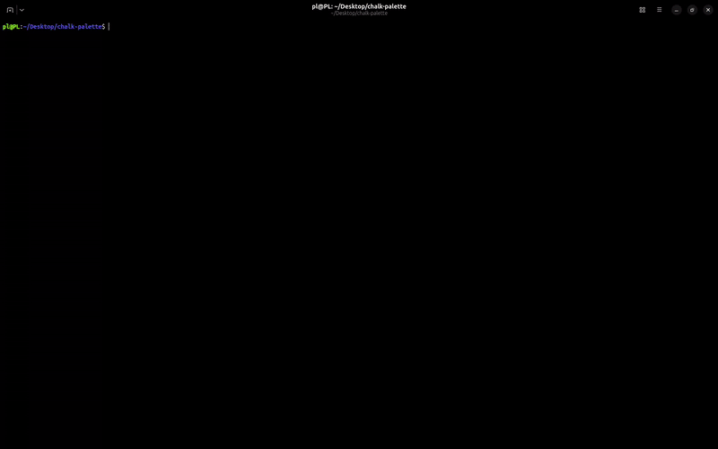
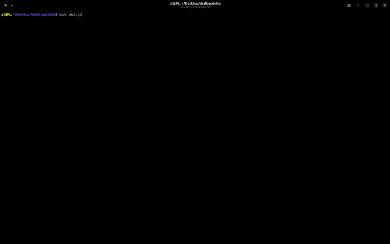
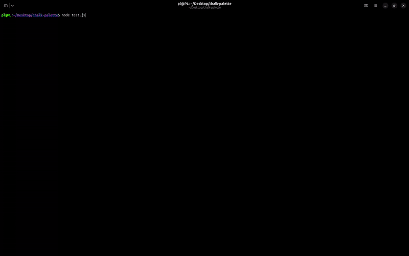
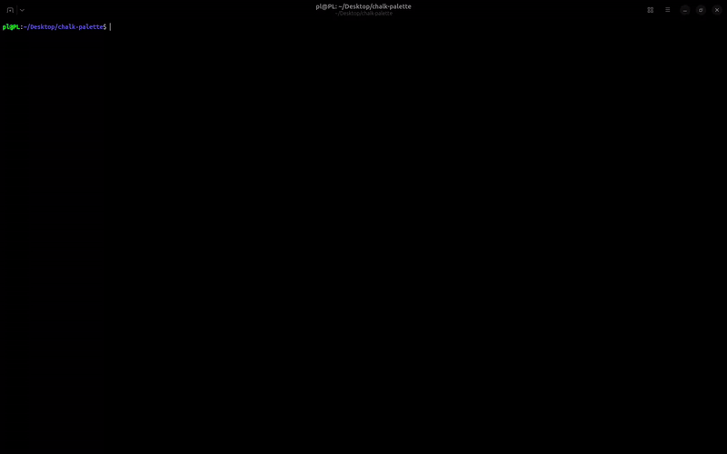
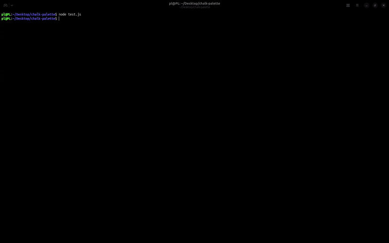
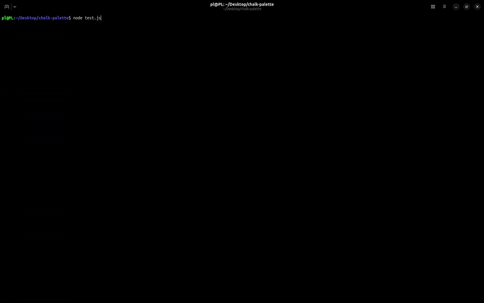

  
  <h1>chalk-palette — Визуальная демонстрация</h1>
  
Нажмите на любую анимацию, чтобы открыть её на весь экран

---

### 🎨 Логотипы и полноэкранные сцены

  <table>
    <tr>
      <td align="center" width="33%">
        <code>playLogo</code>  
        
      </td>
      <td align="center" width="33%">
        <code>drawLogo</code>  
        
      </td>
      <td align="center" width="33%">
        <code>matrix</code>  
        
      </td>
    </tr>
    <tr>
      <td align="center">
        <code>fire</code>  
        
      </td>
      <td align="center">
        <code>plasma</code>  
        
      </td>
      <td align="center">
        <code>mandelbrot</code>  
        
      </td>
    </tr>
    <tr>
      <td align="center">
        <code>retroLines</code>  
        
      </td>
      <td align="center">
        <code>starfield</code>  
        
      </td>
      <td align="center">
        <code>fireforks</code>  
        
      </td>
    </tr>
    <tr>
      <td align="center">
        <code>starfield (2)</code>  
        
      </td>
      <td></td>
      <td></td>
    </tr>
  </table>

---

### 🎥 Медиа и потоки в реальном времени

  <table>
    <tr>
      <td align="center" width="33%">
        <code>videoPlay</code>  
        
      </td>
      <td align="center" width="33%">
        <code>cameraStream</code>  
        
      </td>
      <td align="center" width="33%">
        <code>audioVisualizer</code>  
        
      </td>
    </tr>
  </table>

---

### ✨ Анимации текста и UI

  <table>
    <tr>
      <td align="center" width="25%">
        <code>logoAnimation (forge)</code>  
        
      </td>
      <td align="center" width="25%">
        <code>logoAnimation (pop)</code>  
        
      </td>
      <td align="center" width="25%">
        <code>logoAnimation (slide)</code>  
        
      </td>
      <td align="center" width="25%">
        <code>textAssemble</code>  
        
      </td>
    </tr>
    <tr>
      <td align="center">
        <code>textExplode</code>  
        
      </td>
      <td align="center">
        <code>textDissolve</code>  
        
      </td>
      <td align="center">
        <code>textShimmer</code>  
        
      </td>
      <td align="center">
        <code>typewriter</code>  
        
      </td>
    </tr>
    <tr>
      <td align="center">
        <code>wave</code>  
        
      </td>
      <td align="center">
        <code>spinner</code>  
        
      </td>
      <td align="center">
        <code>progressBar</code>  
        
      </td>
      <td></td>
    </tr>
  </table>

---

### 🕹️ Игры

  <table>
    <tr>
      <td align="center" width="50%">
        <code>snake</code>  
        
      </td>
      <td align="center" width="50%">
        <code>pong</code>  
        
      </td>
    </tr>
  </table>

